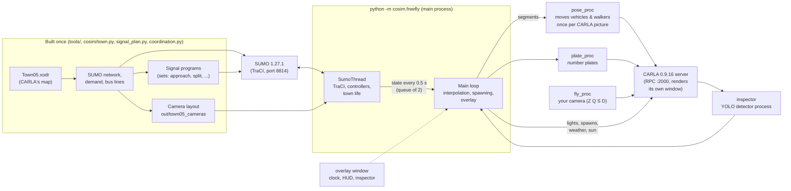

# Urban Traffic CARLA: Town05

A digital twin of a small city. [SUMO](https://eclipse.dev/sumo/) simulates every car, bus, truck, emergency
vehicle and pedestrian in CARLA's **Town05**, and [CARLA 0.9.16](https://carla.org/) draws them in 3D. You fly
over the town in the CARLA window while it runs: coordinated traffic signals, junction AI agents, 55 traffic
cameras with a YOLO detector, accidents with a police and recovery response, three bus lines, and a day and
night clock.

It was built as a companion to *Intelligent Multi-Agent Urban Traffic Management* (ESPRIT capstone).

**SUMO is the master.** SUMO runs the town at its own 0.5 s step, with its own demand and signal control.
CARLA only draws what SUMO decided, so every picture shows a state the simulation really passed through.

---

## Contents

1. [System requirements](#1-system-requirements)
2. [Run it after cloning](#2-run-it-after-cloning)
3. [Using the viewer](#3-using-the-viewer)
4. [Other things you can run](#4-other-things-you-can-run)
5. [Architecture](#5-architecture)
6. [Troubleshooting](#6-troubleshooting)
7. [Licences](#7-licences)
8. [History and notes](#8-history-and-notes)

---

## 1. System requirements

Minimum requirements to run the viewer smoothly:

| | Minimum |
| --- | --- |
| **OS** | Windows 10 or 11, 64-bit |
| **GPU** | NVIDIA GeForce GTX 1650, 4 GB VRAM, DirectX 12 |
| **CPU** | 8 cores / 16 threads (Intel Core i7 11th gen H, AMD Ryzen 7 5800H or better) |
| **RAM** | 16 GB |
| **Disk** | 40 GB free while installing, 35 GB after; an SSD |
| **Display** | 1280 x 720 or larger |
| **Software** | Python 3.11 (64-bit), Git, a recent NVIDIA driver |
| **Network** | About 11 GB to download once (CARLA 7.8 GB; PyTorch about 2.5 GB if you want the detector) |

Why these numbers:
* **GPU.** CARLA uses 2.7 to 3.1 GB of video memory on Town05 at the default render profile, so 4 GB is the floor.
  DirectX 12 matters: on DirectX 11 the same GPU drew about a third fewer pictures.
* **CPU.** Several programs run at once: the CARLA server, SUMO, the viewer and its helper processes (section 5).
  With fewer cores, SUMO falls behind the picture and the traffic stutters.
* **Disk.** The CARLA zip is 7.8 GB and unpacks to about 28 GB. You can delete the zip afterwards. PyTorch adds
  about 5 GB to the Python environment.

Other notes:
* Windows only: the launch scripts, the clock overlay and the key handling use the Windows API.
* SUMO needs no separate install. It comes from pip (`eclipse-sumo`) with the other Python packages.

---

## 2. Run it after cloning

All the steps are double-clicks on `.bat` files. Each one writes a log to `tools\logs\`.

### Step 0: install the prerequisites

* **Python 3.11 (64-bit)** from [python.org](https://www.python.org/downloads/). Keep "py launcher" ticked.
  The CARLA 0.9.16 Python package has wheels for 3.10 to 3.12, and the project is pinned and tested on 3.11.
* **Git** from [git-scm.com](https://git-scm.com/).
* An up-to-date **NVIDIA driver**.

### Step 1: clone

```bat
git clone <this repository's URL> "Urban Traffic CARLA"
cd "Urban Traffic CARLA"
```

The path may contain spaces. Pick a drive with 40 GB free.

### Step 2: download CARLA 0.9.16 (once)

Double-click **`tools\download_carla.bat`**.

* It downloads the official `CARLA_0.9.16.zip` (7.8 GB) into `carla\` and unzips it to `carla\CARLA_0.9.16\`.
  This is where every script looks for it.
* The download resumes if it is interrupted: just run the script again.
* When it says `Done`, you may delete `carla\CARLA_0.9.16.zip`.

If you already have CARLA 0.9.16, copy or move it so that `carla\CARLA_0.9.16\CarlaUE4.exe` exists.

If CARLA later complains about a missing **DirectX runtime**, run `tools\install_directx.bat` once. It downloads
Microsoft's June 2010 runtime, checks its signature and installs it; Windows asks for permission.

### Step 3: create the Python environment (once)

Double-click **`tools\setup_venv.bat`**.

* It creates `.venv\` with Python 3.11 and installs `requirements.txt`: CARLA's client, SUMO 1.27.1, TraCI,
  numpy, pygame and the others.
* It then runs the tests (about 2 minutes) and says `Setup OK.`
* If it reports `No Python 3.11 found`, install Python 3.11 (step 0) and run it again.

### Step 4 (optional): the traffic-camera detector

Double-click **`tools\setup_ml.bat`**. It adds PyTorch 2.6 with CUDA 12.4 (about 2.5 GB), Ultralytics and ONNX
to `.venv`.

You only need it for:
* the **H** camera inspector in the viewer;
* training or evaluating the detector.

Everything else runs without it. Pressing H without it shows an error in the inspector panel and the viewer
carries on.

### Step 5: fly

Double-click **`town05_freefly.bat`** in the project folder. A loading screen appears. The first start takes one
to two minutes, then you are over Town05 with the traffic running.

On every start, the launcher:
1. closes any earlier run;
2. puts two things into your CARLA install:
   * the number-plate meshes (`tools\plates\install_plates.py`). On the first run, CARLA's own plate files are
     first copied to `carla_backup\`, so `install_plates.py restore` can put CARLA back as shipped.
   * a key file (`tools\carla_keys.py`) that turns off CARLA's own W A S D camera movement, because the viewer
     moves the camera itself. CARLA's original file is kept as `DefaultInput.qwerty.ini`.
3. starts CARLA with a render profile, waits until it answers, then starts the viewer (`python -m cosim.freefly`).

The keys are in [section 3](#3-using-the-viewer). Esc quits and closes CARLA.

### Step 6 (optional): the LLM brief

This is a short written brief on the signal evaluation, from a free LLM.
1. Copy `config\env.example` to `.env` in the project folder.
2. Paste at least one key (Groq, Gemini or OpenRouter). `.env` is in `.gitignore`.
3. Run `tools\eval_town05_baseline.bat` (SUMO only, 30 to 60 minutes) so there are results to brief on.
4. Run `tools\town05_brief.bat`. The brief goes to `out\reports\town05_brief.md`.

`tools\llm_check.bat` tests the keys alone.

### Check that everything works

* `tools\test.bat` runs the test suite (log: `tools\logs\test.log`).
* `tools\town05_freefly_demo.bat` runs a 70 s scripted flight at the evening rush with no input from you. It
  writes the frame rate and smoothness to `out\town05_freefly_demo.json` and screenshots to `out\freefly\`.

---

## 3. Using the viewer

Press the keys while the CARLA window is in front.

| Key | Action |
| --- | --- |
| Right mouse button (hold) | Look around |
| **Z / S** | Forward / back, where you look |
| **Q / D** | Left / right |
| **E / A** | Up / down |
| **Shift** (hold) | Twice as fast |
| Arrow keys | Turn left / right, look up / down |
| **F5** | Pause / resume |
| **F6 / F7** | Clock one hour back / forward |
| **F8** | Fly to the next signalised junction |
| **F9** | Hide / show the clock |
| **H** | Near a traffic camera (a blue box on a pole): show its view with the detector's boxes and counts; H again closes it |
| **Esc** | Quit (CARLA closes too) |

The movement keys are Z Q S D because the project was made on an AZERTY keyboard; on a QWERTY keyboard the same
letters work. To fly with W A S D instead, edit `MOVE_KEYS` at the top of `cosim/fly_proc.py`:
`{"Z": 0x57, "Q": 0x41, "S": 0x53, "D": 0x44, "A": 0x51, "E": 0x45}` gives W / A / S / D, with Q down and E up.

On screen:
* top left: the clock and the time of day (one real minute is one hour in town; the time is kept between runs);
* the traffic level;
* camera prompts;
* the accident markers.

### Options

Settings go in environment variables, in a command prompt before the launcher:

```bat
rem keep CARLA in a 1600x900 window instead of borderless full screen
set CARLA_RES=1600x900
rem extra options for the viewer (python -m cosim.freefly --help lists them all)
set FREEFLY_ARGS=--set-time 18:30 --controller agents_observed
town05_freefly.bat
```

`town05_freefly.bat epic` uses CARLA's full Epic quality instead of the lighter default profile
(`tools\fps_test\engine_medium*.ini`).

| Viewer option | Default | What it does |
| --- | --- | --- |
| `--controller` | `coordinated` | Who runs the signals: `coordinated` (one 115 s cycle, green waves), `actuated` (SUMO's actuated programs), `agents_observed` (junction agents fed by the cameras), `agents` (the same agents on exact counts) |
| `--set-time HH:MM` | saved clock | Start the clock at this time |
| `--clock-speed` | 60 | Town seconds per real second |
| `--accidents / --no-accidents` | on | Careless drivers crash; the police and recovery trucks respond |
| `--careless-share` | 0.10 | Share of new cars driven carelessly |
| `--breakdowns / --no-breakdowns`, `--breakdown-every` | on, 2400 | Cars that break down and stop in their lane; seconds between breakdowns on average |
| `--speeders` | 0.08 | Share of new cars driven 25 to 50 % over the limit (three times as often careless) |
| `--pileups / --no-pileups`, `--ring-brake-every` | on, 400 | Pile-ups on the ring road; seconds between sudden hard brakings there on average |
| `--lookalikes / --no-lookalikes` | on | Look-alikes that are not incidents: double-parked delivery vans, buses standing long at a stop |
| `--max-incidents` | 3 | Incidents open at a time at most (the scenes' people and vehicles are made ready for that many) |
| `--police-delay MEDIAN[:SPREAD]` | 240:0.5 | Seconds from a crash to the police car being sent: the median and the spread of a log-normal (0: always the median). `6:0` is the response before 3 Nov |
| `--emergency-every` | 45 | Seconds between ambulance / police runs |
| `--pedestrians-per-km` | 20 | Pedestrians per km of pavement |
| `--no-bus-lines`, `--no-cameras`, `--no-depots`, `--no-plates` | | Leave those parts out |
| `--radius` | 500 | Draw vehicles within this many metres of you |
| `--red-runners` | 0.10 | Share of private cars that may go on through the end of the amber (and so sometimes reach the line on red) |
| `--enforce SIGNAL:ROAD` | | A red-light camera site on that road into that junction (section 5.7), e.g. `1574:-29` |
| `--enforce-agent / --no-enforce-agent` | on | With `--enforce`: the red-light agent watches the site live and files its cases |
| `--enforce-record SECONDS` | 0 | With `--enforce`: record both cameras for that long, then quit |
| `--seed` | 42 | SUMO's random seed |
| `--windowed` | | Keep CARLA in a window (set by `CARLA_RES`) |

### Signal sets

Each set is a double-click; close the viewer first. The choice is kept until you change it.

* `tools\signals_approach.bat` (the default): every approach of a junction gets its own green, and each CARLA
  pole shows one colour.
* `tools\signals_split.bat`
* `tools\signals_leadlag.bat`
* `tools\signals_permissive.bat`

`tools\use_signals.py` with no argument says which set is in use.

---

## 4. Other things you can run

All of these are in `tools\`. Results go to `out\`, logs to `tools\logs\`.

| What | Scripts | Needs CARLA |
| --- | --- | --- |
| Unattended viewer checks with screenshots | `town05_freefly_demo.bat`, `freefly_incident_demo.bat`, `freefly_breakdown_demo.bat`, `freefly_pileup_demo.bat`, `freefly_signals_demo.bat`, `freefly_agents_demo.bat`, `freefly_highway_demo.bat`, `freefly_depots_demo.bat`, `freefly_drivers_demo.bat`, `freefly_poles_demo.bat`, `freefly_demo_cctv.bat` | yes |
| Close the viewer from outside | `stop_freefly.bat` | |
| Render benchmark | `town05_fps_test.bat`, `town05_fps_dx12.bat` | yes |
| Signal controllers compared, SUMO only (step 1) | `eval_town05_baseline.bat` | no |
| Junction agents: tuning and final evaluation on held-out seeds | `tune_town05_agents.bat`, `eval_town05_agents.bat`, `eval_town05_final.bat`, `eval_town05_ablation.bat` | no |
| Real camera reports against SUMO's truth (step 2) | `town05_cameras_plan.bat`, `town05_cameras_live.bat`, `town05_cameras_sim.bat` | live: yes |
| Detector: dataset, fine-tuning, evaluation | `make_dataset_town05.bat`, `train_detector_town05.bat`, `eval_town05_detector.py` | dataset: yes |
| Labelled traffic-camera video clips | `record_incident_clips.bat`, `record_city_crash_clips.bat`, `record_v2_training.bat` | yes |
| Red-light camera: record a site (both cameras, the controller's log, the simulation's own record), live agent on | `record_enforcement.bat` | yes |
| Red-light camera: grade the agent on a recording | `eval_redlight.bat out\enforcement\<recording>` | no |
| Police office: review the cases, issue the notices | `police_office.bat` | no |
| The detector as ONNX (for running the agent without PyTorch) | `export_detector_onnx.bat` | no |
| Rebuild the SUMO scenario from CARLA's map | `build_town05.bat` | no |
| Checks on signals, junction stops, pedestrians, overlaps, accidents | `audit_town05_signals.py`, `check_*.py` | no |
| Every kind of incident, SUMO only, with the ring road and the bus lines | `.venv\Scripts\python tools\check_accidents.py --ring --buses --minutes 60` | no |

`run_cosim.bat` and `python -m cosim.run --help` run the co-simulation as a recorder, in synchronous mode with
camera sensors, instead of the free-fly viewer.

---

## 5. Architecture

### 5.1 The big picture



Three ideas shape the design.

1. **SUMO decides, CARLA draws.** Vehicles in CARLA have physics off; each one is a puppet placed where SUMO says
   (`cosim/carla_side.py`). CARLA's own traffic lights are frozen and set from SUMO's signal states. CARLA's
   autopilot is never used.
2. **CARLA runs asynchronously and draws straight to its own window.** No picture is ever copied to Python. That
   is what makes 30+ pictures a second possible on a 4 GB GPU.
3. **Nothing slow sits on the path to the next picture.** Each slow job lives in its own thread or process,
   connected by queues:
   * the SUMO step;
   * the TraCI calls;
   * spawning actors;
   * loading PyTorch;
   * moving the camera.

### 5.2 What runs at the same time

| Program | Kind | Source | Job |
| --- | --- | --- | --- |
| CARLA server | process (`CarlaUE4.exe`) | `carla\CARLA_0.9.16` | Renders Town05 in its window, at its own frame rate |
| Viewer, main loop | main process | `cosim/freefly.py` (`FreeFly`) | Loads the town, interpolates vehicles between SUMO steps, spawns or parks actors near you, sets lights and weather, draws the overlay, reads the F-keys |
| SUMO thread | thread in the viewer | `freefly.py` (`SumoThread`), `cosim/sumo_side.py` | Steps SUMO (0.5 s) one or two steps ahead of the picture. Runs the signal controller, demand curve, bus lines, emergency runs, accidents and pedestrians' walk phases |
| SUMO | process (started through TraCI) | pip `eclipse-sumo` | The traffic simulation itself (car following, lane changes, junctions, signals) |
| Pose process | process | `cosim/pose_proc.py` | On every CARLA picture (tick callback), places each vehicle and walker for the *next* picture. It is the only thing moving those actors, so nothing judders |
| Fly process | process | `cosim/fly_proc.py` | Reads Z Q S D / A E / Shift / the arrows and moves the spectator once per picture |
| Plate process | process | `cosim/plate_proc.py` | Gives every car its own number plates, front and back |
| Ground process | process | `cosim/ground_proc.py` | Answers road-height queries, so the main loop never waits for the server |
| Detector process | process (on H) | `cosim/inspector.py` | Loads PyTorch and Ultralytics, then runs `models/carla-yolo26n-t05.pt` on the camera's pictures |
| Overlay | window in the viewer | `cosim/overlay.py`, `hud.py`, `incident_hud.py` | A see-through, click-through window laid over CARLA: clock, prompts, markers, inspector |
| Loading screen | process (from the .bat) | `cosim/splash.py` | Shown until the town is ready |

### 5.3 From a SUMO step to a CARLA picture

1. The **SUMO thread** advances SUMO by 0.5 s through TraCI. It applies the signal controller's decisions and
   the town logic (clock-driven demand, buses, emergency vehicles, accidents). Then it reads back every vehicle's
   position, heading, speed, signals and lights, plus the pedestrians and the signal states.
2. That state goes into a **queue of two steps**, so SUMO always runs slightly ahead and the picture never waits
   for it.
3. The **main loop** turns two successive states into a *segment* for each vehicle near you:
   * a Hermite curve between the two positions (`cosim/interp.py`);
   * the heading turning evenly from one step to the next;
   * the road height, looked up on the right level of the raised ring road (`carla_side.py`).
4. It also decides who must be in CARLA:
   * vehicles near you are taken from a pool of parked actors, never spawned during play, since a spawn stalls
     the server;
   * vehicles that leave are parked out of sight;
   * trips that would end in front of you are extended.
5. The **pose process** gets the segment just before it starts. On every CARLA picture it computes where each
   actor is at the moment the next picture is shown, and sends one batch of transforms.
6. **CARLA** draws the picture. Its traffic lights are frozen and set to SUMO's signal states
   (`carla_side.py`), and the walk signals are lit to match (`ped_lights.py`). Sun and weather follow the clock (`cosim/solar.py`, `daily.py`).

### 5.4 Traffic signals: built offline, run live

* **Offline**, the SUMO network is built from CARLA's OpenDRIVE map (`cosim/town.py`, `opendrive.py`,
  `tools/build_town05.bat`), with 15 signalised junctions.
* **Signal programs** come from `cosim/signal_plan.py`. A lane is green only when nothing that crosses it is
  green, by SUMO's own junction geometry. The greens are grouped so that, in the `approach` set, each approach
  goes on its own and each CARLA pole shows one colour.
* **Coordination** comes from `cosim/coordination.py`: one Webster cycle (115 s) for every signal, with greens
  shared by flow and offsets that make green waves along the main roads.
* Each **set** is a group of files in `scenarios/town05/` (`town05.<set>.net.xml`, `.actuated.add.xml`,
  `.webster.add.xml`, `.coordinated.add.xml`). `tools/use_signals.py` copies a set over the files in use.
* **At run time** the controller (`cosim/controllers.py`, chosen by `--controller`) drives SUMO's signals:
  * `coordinated` keeps every junction on the common cycle (`CycleKeeper` in `sumo_side.py`);
  * `actuated` uses SUMO's gap-out logic;
  * the agents modes add the junction agents (5.5).
* **Pre-emption:** an emergency vehicle on a run within 120 m of a signal cuts the conflicting green short, or
  holds its own green.

### 5.5 Junction agents and traffic cameras

* **Cameras.** 55 traffic cameras, one per road at each signalised junction, 9 m up and looking down the road.
  Their poses and lane masks are in `out/town05_cameras/` (`layout.json`, `masks.npz`), planned by
  `tools/town05_cameras.py` and `cosim/perception.py`.
* **Camera reports.** `cosim/camera_reports.py` turns what a camera would see into per-lane reports:
  vehicles counted per lane, and emergency vehicles with siren on / off. It uses the detector's measured error
  model, or real detections in the live mode.
* **Junction agents** (`cosim/agents_actuated.py`). Each junction is an agent on top of SUMO's actuated program.
  SUMO's own program keeps running every signal; the agent steps in only with commands that keep the program's
  states and order. From the reports it:
  * skips a phase nobody is waiting for;
  * ends a green whose cars all face a full exit, or that only a few cars keep alive while others queue;
  * balances greens between short and long approaches before a short one backs up into the next junction;
  * serves an emergency vehicle on a run first;
  * treats someone waiting at a crossing as a call for that green.
  `agents_observed` uses the cameras; `agents` uses exact counts (the upper bound).
* **Detector.** `models/carla-yolo26n-t05.pt` is YOLO26n fine-tuned on CARLA, then on Town05. Its 9 classes:
  car, van, bus, truck, ambulance, ambulance with lights, police, police with lights, pedestrian. In the viewer it
  runs only when you press H (`cosim/inspector.py`, `cctv.py`).

### 5.6 Accidents and the emergency response

* **Why accidents happen.** SUMO's drivers never crash, so a share of drivers is *careless*
  (`cosim/incidents.py`). Now and then one looks away for 1.5 to 3 s, on the phone or through a red light. A
  crash then happens or not depending on the traffic around it. Nothing is staged.
* **The kinds of incident:**

  | Kind | How it happens |
  | --- | --- |
  | Rear-end, side, junction crash | A careless driver looks away (on the phone, or through a red light) |
  | Breakdown | A car puts its hazard lights on and rolls to a stop in its lane; no damage, no debris |
  | Pile-up (3 to 6 cars) | On the ring road, the cars behind a crash, or behind a car that brakes hard all of a sudden, may react late and run into it |
  | Speeding | Some drivers go 25 to 50 % over the limit and are more often careless, so their crashes are harder |

  A car that runs into a stalled car turns the breakdown into a crash.
* **Look-alikes, which are not incidents.** A delivery van stops in its lane with its hazard lights on for 1 to 3
  minutes, or a bus stands at its stop far longer than usual. Nobody responds to them; they are logged so that an
  incident detector can be shown what it must not report.
* **The moment of the crash.** SUMO notices a collision only at the end of its 0.5 s step, the cars already inside
  each other. They are put back to where they first touched (`contact_fraction` in `cosim/incidents.py`), and the
  viewer draws them going on at their speed and stopping dead there, at that moment. The push and turn of the impact
  (`cosim/pose_proc.lay_wreck`) and the debris start at the hit; the hazard lights come on 2 s later. Each incident's
  `t_contact` is that moment on the simulation's clock (`t0` is the step that saw it, up to 0.5 s later). Measured with
  `tools/measure_impact.py` (SUMO alone, the viewer's motion replayed), and in CARLA with the pose process's trace of
  each wreck (`out\freefly\crash_trace.csv`, read by `tools/check_crash_trace.py`). While clips are recorded, every
  recorded camera counts as an eye, so the vehicles it films are posed in every picture.
* **The police response.** The police car is sent minutes after a crash, not seconds: the delay is drawn per
  incident (median 4 min, 5 to 95 % about 1.75 to 9 min, `--police-delay`), and the drive there comes on top (usually under a minute). Each
  incident records when the police were due, sent and on scene, and how they got there (`police` in
  `incidents.json`; `on_scene` stays empty if they never got there).
* **The scene** (`cosim/incident_scene.py`):
  * damage and hazard lights;
  * the lanes blocked in SUMO, so traffic queues and goes round;
  * a police car;
  * a recovery truck that loads the wreck (`cosim/towing.py`).
* **The depots.** The police, ambulances and recovery trucks leave from and return to a hospital, a police
  station and a recovery yard (`cosim/depots.py`).
* `cosim/clip_recorder.py` can film chosen cameras to MP4 with every accident labelled on the simulation's clock
  (the `--record-*` options). Its `incidents.json` gives each incident's kind, cause, cars and speeders, the moment of
  contact and the police record, and the
  look-alikes with the seconds each camera has them in its picture.

### 5.7 Red-light camera and the police office

A red-light enforcement site as real ones are built, at one approach of a signalised junction (`--enforce`,
`tools\record_enforcement.bat` uses junction 1574, road -29). The agent decides from **the pictures and the
controller's signal log only**; SUMO's knowledge of who ran the red is written beside each recording to grade it and
is never given to the agent.

```
 overview camera ─┐                                   ┌─> case folder ──> police office ──> notice (fictional keeper)
 plate camera ────┼─> detector ─> tracker ─> rule ────┤      photos A/B with data bar, clip, plate crop,
 signal log ──────┘   (YOLO26n)   (road     (red ≥    │      case.json with SHA-256 of every file
 (controller)                      metres)  0.5 s)    └─> plate reader (both cameras, voted) ─> vehicle register
```

| Part | What it does | Source |
| --- | --- | --- |
| Site | Two cameras on one pole 24 m before the stop line, 7 m up: the overview (30°, the road from 9 m before the line into the junction) and a narrow plate camera (17°, the last metres before the line, about twice the pixels on a plate) | `cosim/enforcement.py` |
| Clock | Each picture is timed on SUMO's clock (the step it shows); the signal log is SUMO's controller state per step | `cosim/enforcement.py` |
| Detection and tracking | The Town05 YOLO26n detector; each box's back edge placed on the road (metres from the stop line, lane) by the camera's geometry; boxes followed from picture to picture | `cosim/redlight.py` |
| Rule | Front over the line (interpolated between the pictures either side) with the lane's signal red for at least 0.5 s; the vehicle then seen going on (its back 3 m past the line within 5 s, not one stopping just over it); an ambulance or police car with its lights on is exempt | `cosim/redlight.py` |
| Plate | Classic number-plate reading for the Tunisian plate: plate found (character rows, plate-shaped blobs), its panel outlined and straightened, each digit group read with the plate font's own digits; read on several views (the plate camera's pictures of the vehicle, found from where the overview camera has it on the road, and the overview's own), voted; unsure readings never vote | `cosim/anpr.py`, `cosim/redlight.py` |
| Evidence | Photo A (before the line, on red) and B (in the junction) with the data bar real cameras print, a 5 s clip, the vehicle and plate crops, `case.json` with the signal log around it and each file's SHA-256 | `cosim/redlight.py` |
| Register | Every car in town with its plate, make, model, colour and a **fictional** keeper (names, ID numbers and addresses are invented and marked so) | `cosim/register.py` |
| Police office | A desktop window: each case's photos, clip, plate readings and the register's entry; the officer checks the plate, accepts or rejects; a notice (HTML) for the registered keeper; tampered files are flagged | `tools/police_office.py` |
| Grading | The agent run on a recording against SUMO's record: crossings found and their timing, violations caught, missed and falsely accused, plates read right and wrong | `tools/eval_redlight.py` |

Measured on a 40-minute recording with both cameras (`docs/WORKLOG.md`, 1 Nov): both cars that entered on red caught,
no false accusation, the crossing timed within 0.1 s; of the 31 crossing cars found, 22 plates read right, 1 wrong
(an unsure reading, which does not count), 8 unread. A plate is kept only when it has the size and the place the
cameras' calibration expects for that vehicle (a fragment, or another vehicle's plate, is dropped). A reading is
still a proposal: the officer confirms the plate against the photo before a notice is issued.

Drivers who run the end of the amber are `cosim/red_runners.py`: a share of private cars that, when the amber
shows with the line a few seconds ahead, may keep going, and a few that see a fresh red too late. Nothing is placed
or timed: whether they reach the line on amber or red depends only on where they were when it changed.

### 5.8 Town life

| Part | Source |
| --- | --- |
| Clock: one real minute is one game hour; demand follows a daily curve (Little's law on the mean trip); day and night lighting | `cosim/daily.py`, `solar.py` |
| Demand: passenger cars, deliveries, trucks, motorcycles, about 2900 vehicles an hour at the peak | `scenarios/town05/*.rou.xml` |
| Three bus lines on closed loops, with CARLA bus shelters at the stops | `tools/build_town05_pt.py`, `town05.pt.add.xml` |
| Pedestrians on the pavements and crosswalks, with walk signals | `cosim/extras.py`, `ped_lights.py` |
| Ambulances and police on emergency runs | `cosim/extras.py` |
| Traffic on the raised ring road | `cosim/highway.py` |
| Drivers seated in the cars you are close to | `cosim/drivers.py` |
| CARLA blueprint for each SUMO vehicle type | `cosim/vmodels.py`, `blueprints.py`, `config/vehicle_models.json` |

### 5.9 Repository map

```
Urban Traffic CARLA/
├─ town05_freefly.bat        double-click to fly (calls tools\town05_freefly.bat)
├─ cosim/                    the co-simulation (Python package)
│  ├─ freefly.py             the viewer: loading, SumoThread, main loop, demos, recording options
│  ├─ sumo_side.py           SUMO half: TraCI, controllers, walk phases, cycle keeper
│  ├─ carla_side.py          CARLA half: actors, lights, road heights
│  ├─ pose_proc.py  fly_proc.py  plate_proc.py  ground_proc.py   helper processes
│  ├─ overlay.py  hud.py  incident_hud.py  agent_hud.py  splash.py   what is drawn over CARLA
│  ├─ controllers.py  coordination.py  signal_plan.py  signal_heads.py  ped_lights.py  signal_audit.py
│  ├─ agents_actuated.py  agents.py  camera_reports.py  perception.py  inspector.py  cctv.py
│  ├─ incidents.py  incident_scene.py  towing.py  depots.py  highway.py  drivers.py  extras.py
│  ├─ enforcement.py  redlight.py  redlight_proc.py  anpr.py  register.py  red_runners.py   red-light camera
│  ├─ daily.py  solar.py  interp.py  vmodels.py  blueprints.py  plates.py  clip_recorder.py  llm.py
│  └─ town.py  opendrive.py  tlcomplete.py  tlmap.py  convert.py  scenario.py  run.py  live.py   builders, recorder
├─ scenarios/
│  ├─ town05/                SUMO network, demand, bus lines, every signal set, Town05.xodr, scenario.json
│  └─ twin_extras.add.xml    vehicle and pedestrian types for the extras
├─ tools/                    .bat launchers and Python tools (setup, demos, evaluations, builders, checks)
│  ├─ _env.bat               shared paths: .venv, carla\CARLA_0.9.16, tools\logs, out
│  ├─ plates/                number-plate meshes and their installer
│  ├─ carla_config/          the DefaultInput.ini installed into CARLA (CARLA's key movement off)
│  └─ fps_test/              CARLA render profiles (Engine.ini) used by the launcher
├─ models/                   traffic-camera detector weights (AGPL-3.0)
├─ out/town05_cameras/       camera layout and lane masks, read at run time (the rest of out/ is generated)
├─ config/                   vehicle models, LLM providers, env.example
├─ assets/                   fonts and plate textures for the overlay and plates
├─ third_party/carla_sumo/   CARLA's netconvert_carla.py (MIT)
├─ tests/                    pytest suite
├─ docs/WORKLOG.md           dated work log: what was built, why, and the measurements
└─ notes/                    design notes
```

Not in the repository (`.gitignore`), and created on your PC by the steps above:
* `carla/` (the CARLA install);
* `carla_backup/` (CARLA's original plate files);
* `.venv/`;
* `out/` (results, except the camera layout);
* `tools/logs/`;
* `.env` (API keys).

---

## 6. Troubleshooting

| Symptom | What to do |
| --- | --- |
| `CarlaUE4.exe not found under ...` | CARLA is not in `carla\CARLA_0.9.16\`: run `tools\download_carla.bat`, or move your copy there |
| CARLA asks for the DirectX runtime | `tools\install_directx.bat` |
| `CARLA did not answer` | Another CARLA or a firewall is holding port 2000. Run `tools\stop_freefly.bat` and try again; `tools\fresh_carla.bat` restarts the server cleanly |
| The camera shakes or drifts while you move | CARLA's own key movement is still on (a custom `DefaultInput.ini`). `python tools\carla_keys.py status` says why; `install` fixes a stock file |
| Low frame rate | Use the default profile (not `epic`), close other GPU programs, keep a laptop plugged in. `set FREEFLY_ARGS=--pedestrians-per-km 8` draws fewer walkers, which cost the most |
| H shows an error | Run `tools\setup_ml.bat` (PyTorch and Ultralytics) |
| The viewer window closed with an error | Read `tools\logs\freefly_town05.log` |
| Number plates look wrong after another CARLA project | `.venv\Scripts\python tools\plates\install_plates.py restore` puts CARLA's files back; the next start installs ours again |

---

## 7. Licences

* **CARLA**: code MIT, assets CC-BY (<https://github.com/carla-simulator/carla>). Pictures and videos credit
  "CARLA Simulator (CVC, UAB), CC-BY". `scenarios/town05/town05.xodr` and `tools/carla_config/DefaultInput.ini`
  (edited) come from the CARLA package.
* **`third_party/carla_sumo/`**: CARLA, MIT (see its README).
* **SUMO**: EPL-2.0 (installed from PyPI, not copied).
* **Detector weights** in `models/`: fine-tuned Ultralytics YOLO26 weights, AGPL-3.0.
* **Fonts** in `assets/fonts/`: SIL Open Font License (files next to them).

---

## 8. History and notes

* [`docs/WORKLOG.md`](docs/WORKLOG.md) is the dated log of how the project got here: each feature, why it was done
  that way, and what was measured. That includes:
  * the frame-rate work;
  * the signal designs and their evaluation;
  * the junction agents' results;
  * the detector's training;
  * accidents, depots, plates and lamps.
* [`notes/`](notes/) holds design notes on the junction agents.
